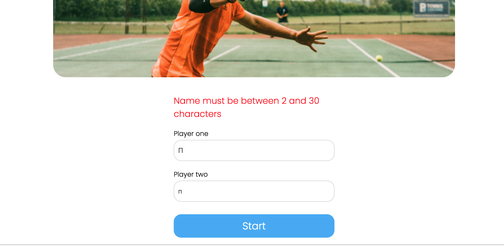
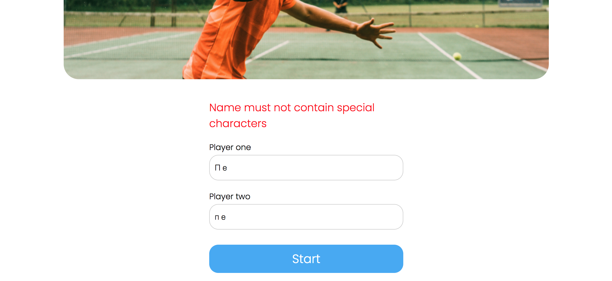
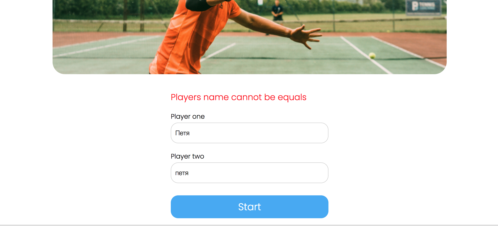
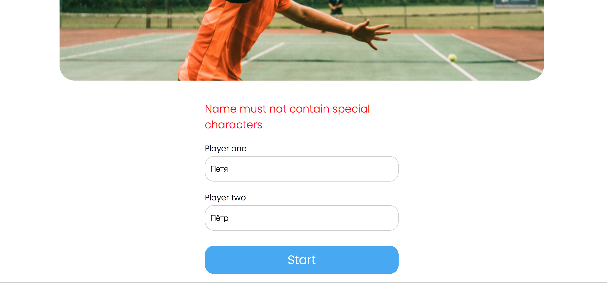
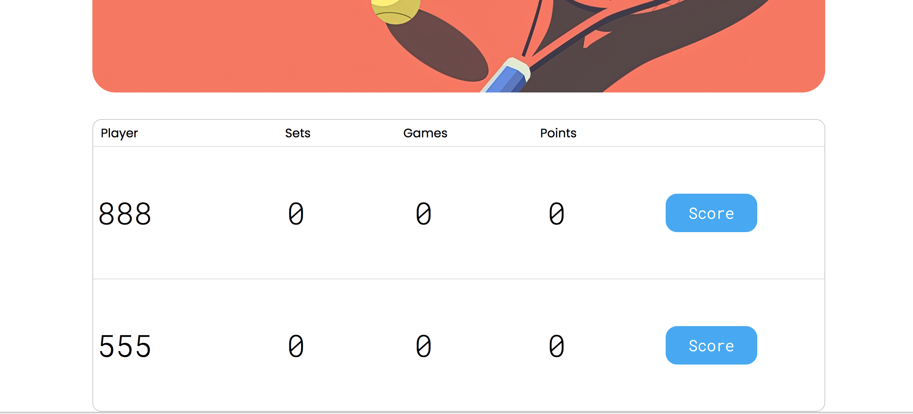
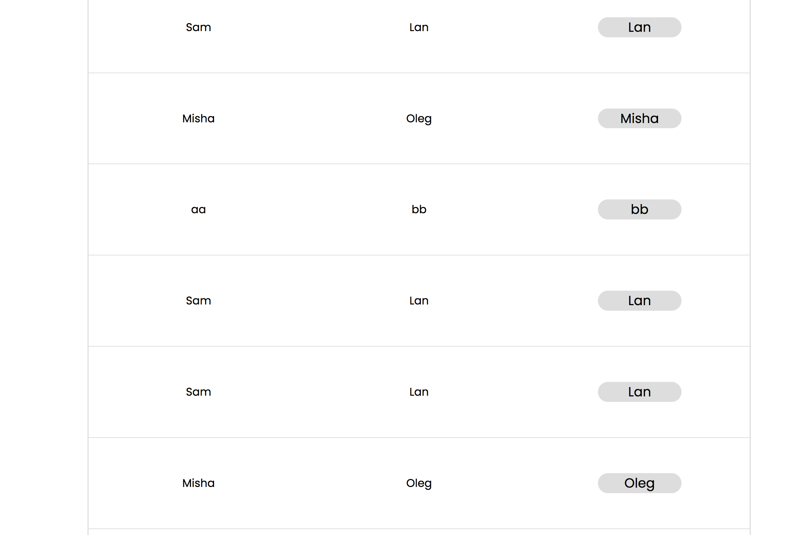
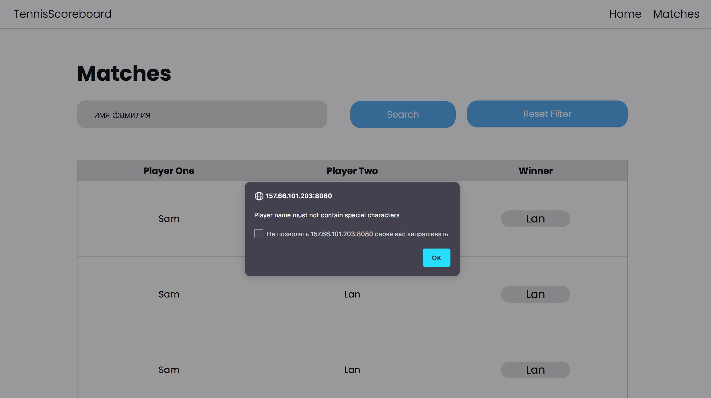

```text
Знаком ❗️ помечены критически важные замечания, а также места нарушения ТЗ.
```

## Функциональный обзор

- Сообщения об ошибке валидации имени сейчас отображаются по очереди:







Это ухудшает пользовательский опыт. Лучше сразу отображать все сообщения, чтобы пользователь мог исправить всё разом.

- Сейчас нельзя создать игроков с буквой ё в имени:



Стоит разрешить букву ё, пробелы, дефисы и апострофы.

- Сейчас можно создать игроков с такими именами:



Раз в проекте есть валидация, стоит добавить проверку, что в имени есть буквы.

- ❗️Последний сыгранный матч отображается на непредсказуемой позиции в середине списке на странице завершённых матчей — чтобы посмотреть его результат в таблице надо внимательно просматривать много матчей. Лучше, чтобы последний завершённый отображался первым в списке (на первой странице).



- ❗️Сейчас если в поисковом запросе есть пробелы, то возвращается ошибка 400.



Лучше при любом поисковом запросе возвращать результат — список матчей или пустой список, а не ошибку.
