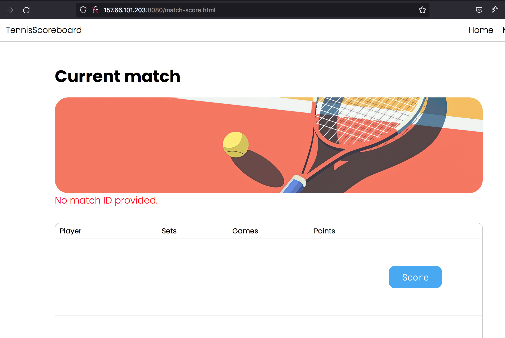

```text
Знаком ❗️ помечены критически важные замечания, а также места нарушения ТЗ.
```

## В целом по проекту

- ❗️По ТЗ в проекте не должен использоваться Spring Boot

- Но если проект использует Spring Boot, то для его запуска не нужен внешний Tomcat (он подтягивается транзитивно через стартер `spring-boot-starter-web`). 

Чтобы привести конфигурацию к стандартному Spring Boot приложению надо:

  - Удалить зависимость `org.springframework.boot:spring-boot-starter-tomcat` с областью видимости `provided` из pom.xml. 
  - Spring Boot проект по умолчанию собирается в JAR, поэтому также стоит удалить строку `<packaging>war</packaging>` в pom.xml. 
  - В главном классе приложения (TennisScoreboardApplication) убрать наследование от SpringBootServletInitializer и переопределение метода `configure`.

- Местами в классах не хватает форматирования. Перед `git commit` можно нажимать (`cmd + alt + l` в Idea на mac os). Это работает как для текущего класса, так и для всего пакета: если выделить пакет и нажать комбинацию клавиш, то исправление форматирования будет выполнено для всех классов в этом пакете.

- Где-то числительные, обозначающие игроков, написаны цифрами (player1, player2), а где-то словами (firstPlayer, secondPlayer) — лучше выбрать один подход и во всём приложении использовать его.

  Отсутствие единого, последовательного стиля именования может затруднять чтение кода. Разработчику приходится тратить дополнительное время и умственные усилия, чтобы убедиться, что `player1` и `firstPlayer` являются обозначениями одной и той же сущности. Это создаёт ненужную когнитивную нагрузку.

  Также непоследовательное именование повышает риск случайных ошибок, особенно при копировании/вставке кода или при работе с большим количеством схожих переменных, когда легко перепутать один стиль с другим.

  Стоит привести именование к единому стилю, используя либо только цифры, либо только слова.

  Использование слов (например, `firstPlayer` и `secondPlayer`) даёт несколько преимуществ перед использованием цифр:
  - Визуальное различие и читаемость: Имена `firstPlayer` и `secondPlayer` визуально отличаются друг от друга сильнее, чем `player1` и `player2`. Это снижает вероятность их перепутать при быстром просмотре кода. Кроме того, такие имена читаются более естественно, как обычный текст.
  - Скорость работы в IDE: При вводе `first...`, IntelliJ IDEA однозначно предложит подсказку `firstPlayer`. При вводе `player...` IDE предложит оба варианта (`player1`, `player2`), что требует дополнительного действия для выбора нужного.
  - Удобство поиска: Искать по кодовой базе переменную тоже `firstPlayer` может быть проще, чем `player1` (по причине, из предыдущего пункта).

- ❗️Учётные данные из application.properties не должны попадать в github. Можно коммитить шаблон файла (application.properties.example), который будет содержать только названия всех необходимых переменных, но без их реальных значений.

- ❗️Сейчас HTML страницы находятся в `src/main/resources/static` и любая страница доступна по прямому URL.

Например, сейчас можно открыть http://157.66.101.203:8080/match-score.html и увидеть пустую страницу, предназначенную для текущего матча, котора должна быть доступна только при определённых условиях (когда матч создан).



Стоит найти способ это исправить.
